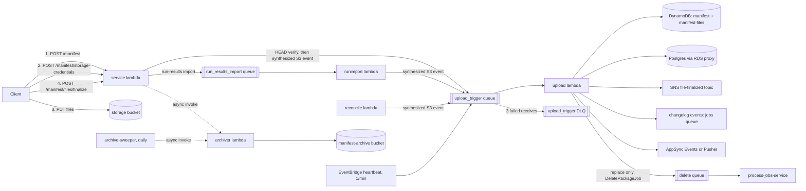

# upload-service-v2

Version 2 of the Pennsieve upload service. Clients register a manifest of files, upload the files straight to the
storage bucket, and tell the service they are done ("finalize"). The service then verifies each file against the
manifest and creates the folders, packages and file rows in Postgres.

The repository is a set of Go AWS Lambda functions (`lambda/`), two small shared Go modules (`pkg/`), and the
Terraform that deploys them (`terraform/`).

## Architecture

| Lambda (`lambda/`) | Trigger | What it does |
|---|---|---|
| `service` | API Gateway (HTTP API "Upload Manifest API", defined in `terraform/upload-service.yml`) | The public API: create/sync manifests, list files and status, issue scoped storage credentials, finalize files, import workflow-run results, archive/download/delete archived manifests. |
| `upload` | SQS `upload_trigger` queue (batch size 25, 1s batching window, partial batch failures) | The importer. Verifies each file against the manifest, creates folders, packages and file rows in Postgres, updates storage counters, emits events and notifications. Also handles replacement of existing files. |
| `runimport` | SQS `run_results_import` queue (batch size 1, max concurrency 20) | Copies one file of a workflow run's results from the compute account into dataset storage, then hands it to the `upload` lambda through the upload trigger queue. Runs outside the VPC. |
| `reconcile` | EventBridge, hourly (`gracePeriodHours: 6`); also invokable by hand | Recovers files stuck in `Registered`: HEAD-checks the storage object and re-enqueues recoverable files to the upload trigger queue. Never deletes. Has a manual one-manifest mode and a read-only `reportOnly` audit of `FailedOrphan` rows. |
| `archiver` | Async invoke (by `service` and by `archive-sweeper`) | Writes a manifest's file rows to a CSV in the manifest-archive bucket and, when asked, marks the manifest `Archived` and removes its file rows from DynamoDB. |
| `archive-sweeper` | EventBridge, daily at 07:30 UTC | Finds manifests older than `maxAgeDays` (default 90) that are not `Archived` and asynchronously invokes `archiver` for each (default cap 50 per run). Only dispatches; never changes state itself. |

State is kept in two places. Manifests and per-file upload status live in DynamoDB (a manifest table and a
manifest-files table). The resulting packages, files, folders and storage counters live in Postgres (the per-organization schema).

## Normal upload flow

1. **Create or extend a manifest.** The client calls `POST /manifest` on the `service` lambda with a list of files.
   With no manifest id a new manifest is created (status `Initiated`); with an id, the files are synced into the existing
   manifest (unless it is `Archived`). Each file gets an upload id and starts in `Registered` status.
2. **Get upload credentials.** `POST /manifest/storage-credentials` returns short-lived STS credentials (one hour)
   limited to `PutObject` and multipart-upload actions under the manifest's prefix in the destination storage bucket,
   `O{orgId}/D{datasetId}/{manifestId}/*`. The response also carries the bucket, key prefix and region.
3. **Upload.** The client writes each file directly to the storage bucket at `<keyPrefix>/<uploadId>`. There is no
   intermediate uploads bucket and no move step any more (the legacy uploads-bucket pipeline was removed in #117).
4. **Finalize.** The client calls `POST /manifest/files/finalize` with the manifest id and, per file, the upload id,
   size and SHA-256 (required), plus an optional `onConflict` (`keepBoth`, the default, or `replace`). For each file the
   service rejects upload ids that are not in the manifest, treats files already `Finalized` as done, and HEAD-checks
   the object in S3: it must exist, match the size and match the SHA-256 S3 stored. Files that pass are queued to the
   upload trigger queue as a synthesized S3 "object created" event with the conflict strategy in an `OnConflict` message
   attribute. The response reports each file as `finalized` or `failed`; "finalized" here means "queued for import".
5. **Import.** The `upload` lambda receives batches from the queue:
   - Heartbeat messages (no S3 records) are dropped before it connects to Postgres.
   - Each message is parsed for `{manifestId}/{uploadId}` and the object is HEAD-checked. Keys that do not parse, or
     upload ids not present in the manifest, are treated as orphans and deleted from S3 (keys starting with `/` are
     never deleted).
   - Files are grouped by manifest. For each manifest the lambda looks up the manifest and uploading user, sets the
     Postgres search path to the manifest's organization, and calls `ImportFiles`.
   - `ImportFiles` skips files already imported (see below), creates any missing folders (its own transaction), then
     creates the package and file rows in one transaction. Then it increments storage on the organization, the dataset
     and every ancestor package; publishes a `FileFinalized` event per file to the SNS file-finalized topic (used by the
     virus scan service); emits a `CreatePackage` changelog event; and notifies subscribers of the dataset.
   - On success the manifest file rows move to `Finalized` and the dataset's `updated_at` is bumped.
6. **Realtime notification.** Where `REALTIME_EVENTS_ENDPOINT` is set (dev, today) the lambda publishes an
   `upload-event` to the AppSync Event API (up to 500 rows per event); otherwise it uses Pusher. A failed notification is
   logged and never fails the upload.

**Package state.** Every uploaded package is created in state `UPLOADED`, meaning "waiting for its virus scan"
(#122). The scan service moves it on after it records the file's scan status: clean, format-validated or unscanned
files go to `READY`, infected files to `ERROR`. The import itself no longer decides the state.

**Failures.** If importing a manifest's batch fails, the lambda retries each file on its own, so only the files that
fail are returned to SQS as batch item failures.

## Replacement flow (`onConflict: "replace"`)

By default (`keepBoth`) a new file whose name collides with an existing package in the same dataset and folder is
renamed with a " (N)" suffix. With `onConflict: "replace"` the new file takes over the name instead.

1. The strategy travels from the finalize request (or, for run-results imports, from the target's overwrite setting)
   in the `OnConflict` SQS message attribute. A missing, empty or unknown value means `keepBoth`.
2. Inside the import transaction, go-core's `AddPackagesWithConflict` with the Replace strategy finds the existing
   non-deleted package with the same name under the same parent and, for each one:
   - soft-deletes it: state becomes `DELETING` and its name is prefixed `__DELETED__<nodeId>_`, which frees the name;
   - inserts the new package with `replaces_package_id` pointing at the predecessor;
   - sets the predecessor's `replaced_by_package_id` to the new package.

   Still in the same transaction, `packagedelete.RecordPendingJobs` writes one `PENDING` row per predecessor to the
   workspace's `delete_jobs` table (`source = UPLOAD_REPLACE`, `user_node_id` = the uploader, `trace_id` = the manifest
   id). If that insert fails, the whole import rolls back, including the `DELETING` flip.
3. Only files can be replaced. Collections are rejected by go-core, and a database CHECK constraint forbids
   `replaces_package_id` / `replaced_by_package_id` on collections.
4. After the transaction commits, `packagedelete.EnqueueJobs` sends one `DeletePackageJob` per recorded job to the
   delete queue (in SQS batches of 10, five in parallel). The message `id` is the `delete_jobs` row id. The delete queue is consumed by
   [process-jobs-service](https://github.com/Pennsieve/process-jobs-service), which does the actual cleanup.
5. The notification for the new package carries `replaced_package_id` so the web app can drop the old row.
6. The lambda emits an EMF metric record in the `UploadService/Replace` namespace with `ReplacementCount` and
   `ReplacementPublishFailures`, and logs a warning when one batch replaces more than 100 files.

`replaces_package_id` and `replaced_by_package_id` are provenance only. They do not delete anything: the old package
is deleted by the delete job.

**If the send fails.** The error is logged and counted in `ReplacementPublishFailures`, but the import is not failed
or retried. Because the `PENDING` row was committed with the flip, the predecessor is not stranded unnoticed: the
aged `PENDING` row is what the delete-jobs monitor in process-jobs-service alarms on and what re-drive picks up. See
go-core's `pkg/packagedelete/README.md` for the delete path and the producer contract.

**Deploy order.** The `delete_jobs` migration (pennsieve-db-migrations) must be applied in an environment before this
lambda is deployed there. Without the table the insert fails and every replace import rolls back.

## Duplicates, retries and recovery

- **At-least-once delivery.** Both finalize and S3 can deliver the same file more than once, and a duplicate can arrive
  while the first import is still running. `dropAlreadyImported` looks up the upload ids in the files table and drops any
  already imported, so a duplicate is a successful no-op (#113). Duplicates within one batch are also collapsed.
  This matters for replace, where re-importing would rename the just-created package, and for `keepBoth`, where storage
  would be counted twice.
- **Queue settings.** The upload trigger queue has a 300s visibility timeout, 1 day retention, and a dead-letter queue
  after 3 receives (DLQ retention 1 week). The upload lambda has reserved concurrency 100 to protect RDS. The
  `ReportBatchItemFailures` response type means only failed files are retried.
- **Heartbeat.** EventBridge posts `{"heartbeat": true}` to the upload trigger queue every minute to keep the lambda's
  pollers warm; the lambda discards these.
- **Reconcile.** Files that stay `Registered` past the grace period are HEAD-checked and re-enqueued. If the object is
  gone, the file is counted and logged (and can be marked `FailedOrphan`); a re-sync of the manifest resets
  `FailedOrphan` files to `Registered` so they can be retried. Manifests whose dataset has been deleted are not retried.
- **Archive.** The sweeper hands old manifests to the archiver, which writes a CSV to the archive bucket (versioned,
  AES256) and removes the manifest's file rows. `GET /manifest/archive` returns a pre-signed URL for the CSV;
  `DELETE /manifest/archive` removes an archived manifest.
- **Run-results imports.** `POST /manifest/run-results/import` is called with a workflow run's callback token.
  The service validates the token, confirms the target is one of the run's dataset targets for that dataset, registers
  the files in a deterministic manifest (so retries and later pages land on the same rows) and queues one copy job per
  file. `runimport` copies each file (read with the compute account's role, written with the storage-credentials role)
  and queues it to the upload trigger queue, so the package is created like any direct upload. After 3 attempts the
  copy lambda marks the file `Failed` itself; that queue's DLQ is for inspection. `GET /manifest/run-results/import`
  reports progress.
- **Alarms.** CloudWatch alarms cover both DLQs, the reconcile metrics, and the archive-sweeper metrics
  (see `terraform/cloudwatch.tf`).

## Configuration

Set by Terraform on each lambda (`terraform/lambda.tf`); not every lambda uses every variable.

| Variable | Used by | Meaning |
|---|---|---|
| `MANIFEST_TABLE`, `MANIFEST_FILE_TABLE` | service, upload, archiver, reconcile, archive-sweeper (table only), runimport (file table only) | DynamoDB table names |
| `RDS_PROXY_ENDPOINT` | service, upload, archiver, reconcile | Postgres access |
| `DEFAULT_STORAGE_BUCKET` | service, reconcile | Default destination storage bucket |
| `STORAGE_CREDENTIALS_ROLE_ARN` | service, runimport | Role assumed (with a session policy) for scoped S3 write access |
| `UPLOAD_TRIGGER_QUEUE_URL` | service, reconcile, runimport | Queue read by the upload lambda |
| `FILE_FINALIZED_TOPIC` | upload | SNS topic for `FileFinalized` events |
| `JOBS_QUEUE_ID` | upload | Queue for changelog events |
| `DELETE_QUEUE_ID` | upload | Delete queue (replacement jobs) |
| `REALTIME_EVENTS_ENDPOINT` | upload | AppSync Event API; empty means use Pusher (config read from SSM `/ops/pusher-config`) |
| `ARCHIVE_BUCKET` | service, archiver | Manifest-archive bucket |
| `ARCHIVER_INVOKE_ARN` / `ARCHIVE_LAMBDA_ARN` | service / archive-sweeper | Archiver function |
| `RUN_RESULTS_IMPORT_QUEUE_URL`, `CALLBACK_VALIDATOR_FUNCTION`, `COMPUTE_NODES_TABLE`, `ACCOUNTS_TABLE` | service | Run-results imports |
| `MAX_ATTEMPTS` | runimport | Copy attempts before a file is marked `Failed` |
| `LOG_LEVEL`, `REGION`, `ENV`, `PENNSIEVE_DOMAIN` | various | Logging and environment |

Other Terraform resources: two DynamoDB tables (manifest table keyed by `ManifestId` with `DatasetManifestIndex` and
`ManifestStatusIndex`; manifest-files table keyed by `ManifestId`/`UploadId` with `StatusIndex`, `InProgressIndex`
and `PathIndex`, and a TTL attribute), the manifest-archive bucket, the file-finalized SNS topic, a reconcile-alerts SNS
topic, the HTTP API gateway, and the optional realtime wiring (`terraform/realtime.tf`, on by default in dev only).

## Testing

__Jenkins testing__

Jenkins runs `make test-ci` on every push to a branch. Passing tests are required to merge into main.

__Local testing__

Run `make test`. It starts MinIO, DynamoDB Local and a Postgres test database with Docker Compose and runs
`run_tests.sh` inside a Go container, which runs `go test` for the service, upload, archiver and runimport lambdas and
for `pkg/runresults` and `pkg/uploadtrigger`.

The `local_tests` container also mounts `../pennsieve-go-core` next to this repository, so you can work against a local
go-core by adding a `replace github.com/pennsieve/pennsieve-go-core => ../../../pennsieve-go-core` directive to a
lambda's `go.mod` (the `go.mod` files carry this line commented out). Without it, the pinned go-core release from
`go.mod` is used.

## Deployment

__Build and Development Deployment__

Jenkins builds all lambdas (`make package`, linux/arm64 zips) and publishes them to S3 (`make publish`) on every merge to
main, then triggers the dev `service-deploy` job with the new `IMAGE_TAG` (`<build number>-<commit>`), which runs
Terraform `apply`.

__Deployment of an Artifact__

1. Deployments to *development* are done automatically by Jenkins once you merge a feature branch into main.
2. Deployments to *production* are done via Jenkins.
   1. Determine the artifact version you want to deploy (you can find the latest version number in the development deployment job).
   2. Run the production deployment task with the new `IMAGE_TAG`.
